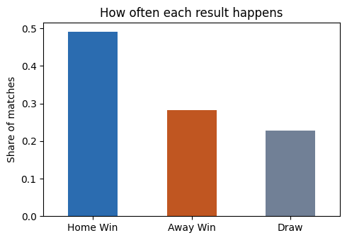
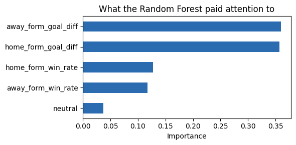
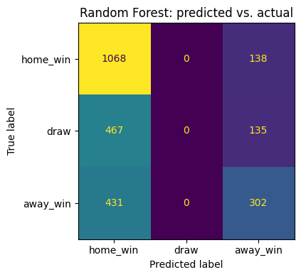

# FIFA World Cup 2026 Match Outcome Predictor


A machine learning model that predicts international football match outcomes — **Home Win / Draw / Away Win** — trained on real historical data and applied to the real 2026 FIFA World Cup fixtures.

This is a learning/portfolio project built to practice the full ML workflow: sourcing real data, feature engineering with careful attention to data leakage, training and comparing models, and evaluating results honestly (including where the model falls short).

## What it predicts

Given two teams and a fixture, the model predicts the **result of that single match** — not a tournament-wide champion. It's a match-level classifier, not a bracket simulator.

## Data

[International football results, 1872–present](https://github.com/martj42/international_results) — a public dataset of ~49,500 international matches (date, teams, scores, tournament, venue). The notebook downloads it directly, so no data files are stored in this repo.

To keep this an honest forecasting exercise, the model is only trained on matches **before June 11, 2026** (when the World Cup kicked off) — it never sees any 2026 World Cup results during training.

## Approach

1. **Feature engineering** — each team's rolling form going into a match: win rate and average goal difference over their last 10 games, computed using only *prior* matches (`.shift(1)`) to avoid leaking future results into training data.
2. **Time-based train/test split** — trained on matches before 2024, tested on 2024 through mid-2026, so evaluation reflects predicting genuinely unseen future matches rather than a random shuffle.
3. **Models compared** — Logistic Regression (baseline) vs. Random Forest, both benchmarked against a naive "always predict home win" baseline.
4. **Applied to real fixtures** — the trained model predicts the actual 2026 World Cup group-stage matchups using each team's real pre-tournament form.

## Results

| Model | Accuracy |
|---|---|
| Naive baseline (always "home win") | 47.5% |
| Logistic Regression | **54.4%** |
| Random Forest | 53.9% |

Both models beat the naive baseline, but neither reliably predicts draws — a well-known limitation in football prediction, since draws don't have a strong statistical "signature" the way a dominant team's win does.

<p align="center">
  
  
</p>

<p align="center">
  
</p>

## Getting started

```bash
git clone https://github.com/<your-username>/fifa-wc26-match-predictor.git
cd fifa-wc26-match-predictor
pip install -r requirements.txt
jupyter notebook notebooks/WC26_ML_Project.ipynb
```

Run all cells top to bottom. The first cell needs an internet connection to download the dataset.

## Possible improvements

- Elo ratings that update after every match, instead of a fixed 10-match rolling window
- Head-to-head history between specific teams
- Gradient boosting (XGBoost / LightGBM) instead of Random Forest
- Proper hyperparameter tuning via cross-validation
- A small web app (Streamlit) for live predictions

## License

MIT — see [LICENSE](LICENSE).
